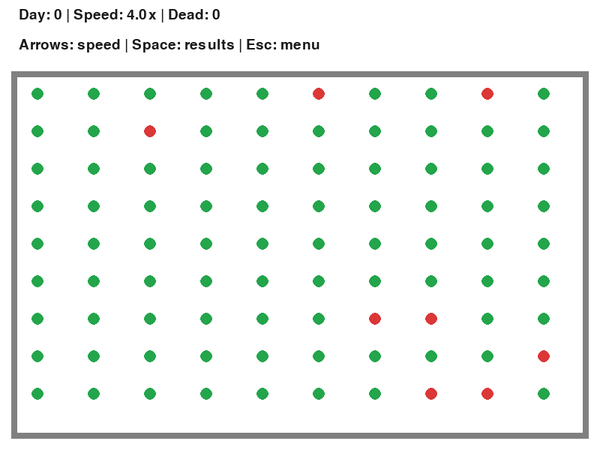
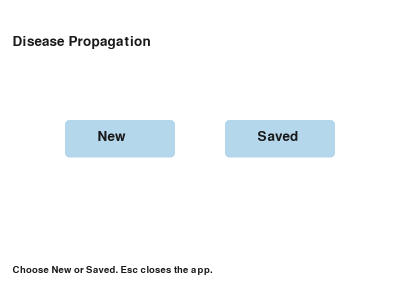
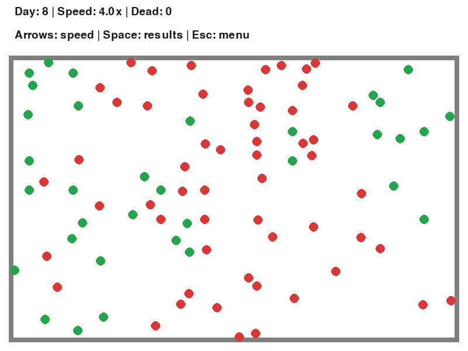
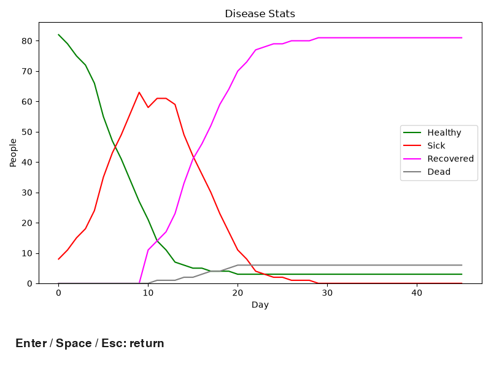

# Disease Propagation Simulator

An interactive agent-based disease simulation built with Python, Pygame, and Matplotlib. Originally a Grade 12 computer science project, it now separates calculations from the interface so disease rules and collision algorithms can be tested and measured independently.

This animation captures the actual application renderer using seed 42 at 4x speed. Green agents are healthy, red are sick, and pink have recovered with immunity. Dead agents are removed and counted in the results.

## Features

- Configure contagiousness, population density, distancing, recovery, mortality, immunity, and initial infection percentage.
- Save named scenarios and load the original saved.txt format; empty or malformed records do not crash navigation.
- Change speed while keeping movement, contacts, and disease progression synchronized.
- View daily healthy, sick, recovered, and deceased counts in an in-app chart without Tkinter.
- Run deterministic simulations without graphical dependencies.
- Compare a spatial grid with a correct pairwise reference and the preserved historical detector.

## Install and run

Use Windows 64-bit Python 3.13. The measured interpreter identifies as CPython 3.13.0rc3; exact versions are recorded in [benchmark_results.json](docs/benchmark_results.json). Python 3.14+ compatibility is not established here.

~~~powershell
git clone https://github.com/abubakrnafees/Disease-Propigation-Simulator.git
cd Disease-Propigation-Simulator
py -3.13 -m venv .venv
.\.venv\Scripts\python.exe -m pip install -r requirements.txt
.\.venv\Scripts\python.exe main.py
~~~

If you already have the repository and environment, use the last two commands. Explicitly using .venv avoids installing dependencies into one Python and running another. In VS Code, use **Python: Select Interpreter** and choose .venv\Scripts\python.exe.

Runtime dependencies are Pygame and Matplotlib. NumPy and Pillow are Matplotlib dependencies; Pillow is explicitly listed in requirements-dev.txt for media capture. Tests use standard-library unittest.

## Usage

Choose **New**, type each setting, and press **Enter**. Correct invalid inputs with **Backspace**. Choose whether to save the scenario before starting. **Saved** loads named scenarios.

| Screen | Controls |
|---|---|
| New scenario | Type, Backspace, Enter; Esc returns |
| Saved scenarios | Left/Right wraps through entries; Enter runs; Esc returns |
| Simulation | Right speeds up; Left slows down; Space ends with results; Esc returns |
| Results | Enter, Space, or Esc returns |
| Main menu | Click New/Saved; Esc exits |

Percentages accept integers from 0 to 100. Population setting 1/2/3 creates 90/45/36 agents, preserving the current application's layout. Recovery accepts 1–365 days. Immunity is 1 for yes or 2 for no. Distancing keeps selected agents stationary; moving agents can still contact them.

At 1x, a day takes two seconds and contains 120 fixed updates. Speed ranges from 0.2x to 20x. Simulations finish after 365 days or when ended manually. Charts include day zero and daily snapshots; ending between boundaries shows the latest recorded day. Initial infection and distancing are probabilistic selections, not exact percentage quotas.

Saved scenarios remain beside main.py regardless of the terminal's current directory. Loading never rewrites existing records.

| Menu | Simulation | Results |
|---|---|---|
|  |  |  |

## Architecture

~~~text
main.py                      Application entry point
simulator/
  app.py                     Pygame screens, controls, and rendering
  config.py                  Validated settings and text persistence
  person.py                  Agent state, movement, boundary reflection
  collision.py               Grid/pairwise candidates and separation
  engine.py                  Seeded updates, progression, statistics, clock
  reporting.py               Agg charts rendered into Pygame
benchmarks/
  run.py                     Update and historical detector measurements
  legacy_collision.py        Verbatim original collision functions
tests/                       Engine, configuration, baseline, and UI tests
scripts/capture_demo.py      Reproduce screenshots and animation
docs/                        Baselines, measurements, decisions, report
assets/                      Actual application captures and settings
~~~

The engine, agents, collision code, and configuration use only the standard library. The interface owns the window and reads engine state; calculations never draw. Charts use Agg to avoid a second event loop and the earlier Tcl/Tk installation failure. See [technical decisions](docs/DECISIONS.md).

A minimal headless run:

~~~python
from simulator.engine import Simulation

simulation = Simulation([40, 1, 25, 14, 5, 2, 5], seed=42)
for _ in range(120):
    simulation.update()
print(simulation.day, simulation.counts())  # day; healthy, sick, recovered, dead
~~~

## Model and algorithms

Each fixed update moves mobile agents by one pixel, reflects at the boundaries, resolves contacts, and applies transmission. Contact distance is 16 pixels, twice the agent radius. Susceptible agents have the configured infection chance per processed contact with someone sick at the start of that update. Newly infected agents cannot transmit until the next update. At daily boundaries, agents whose recovery duration has elapsed either die or recover; immunity determines whether survivors become recovered or susceptible again.

The grid uses 16-pixel cells and checks each agent's cell plus eight neighbors. Pairs are processed once in the same order as the pairwise reference. Collision separation can move agents across cells, so membership and remaining candidates are refreshed when needed. This preserves sequential behavior and random-draw order.

Pairwise selection checks n(n-1)/2 candidates: quadratic time. With bounded local occupancy, grid work is approximately linear in population plus nearby pairs, with local sorting and refresh costs. Crowded cells can still cause quadratic candidate counts; bookkeeping can exceed quadratic runtime in pathological cases. This is not a guaranteed linear-time algorithm.

The historical recursive detector remains available for comparison, including missed contacts and duplicates. Its original “logarithmic” comment does not describe whole-algorithm complexity. It is not used by the app.

## Tests

~~~powershell
.\.venv\Scripts\python.exe -m unittest discover -v
~~~

Tests cover transmission extremes, contact radius and cell boundaries, overlaps, recovery/mortality/immunity, population conservation, seeded reproducibility, speed/frame-rate invariance, persistence errors, input retries, navigation, charts, and closing screens. Headless UI tests use real Pygame drawing and events. Baseline tests check source hashes and compare the engine with the frozen pre-refactor app. The grid is checked against the pairwise reference with moving and stationary agents.

## Performance

The table measures **full simulation updates without rendering**, comparing two strategies in the same engine. It does not measure application FPS or claim a speedup over the incomplete Grade 12 detector.

| Agents / layout | Pairwise µs/update | Grid µs/update | Time reduction | Grid updates/s | Pairwise / grid candidate checks |
|---|---:|---:|---:|---:|---:|
| 30 / uniform | 100.5 | 64.8 | 35.6% | 15,443 | 435 / 1.6 |
| 60 / uniform | 389.8 | 130.9 | 66.4% | 7,642 | 1,770 / 7.7 |
| 90 / uniform | 781.3 | 175.6 | 77.5% | 5,695 | 4,005 / 18.3 |
| 300 / uniform | 7591.5 | 619.7 | 91.8% | 1,614 | 44,850 / 216.9 |
| 90 / dense | 751.5 | 328.9 | 56.2% | 3,040 | 4,005 / 167.3 |

Seven seeded trials each use 120 warm-up updates and 480 timed updates. Strategy order alternates, and garbage collection is disabled during timing for both paths. The recorded machine runs Windows 11, an Intel Family 6 Model 197 processor, and CPython 3.13.0rc3. Samples, standard deviations, environment, dependencies, and settings are in [the raw results](docs/benchmark_results.json). Results vary by machine and workload.

Both strategies produced identical final agent state, daily history, and random-generator state in every measured trial. Original-detector accuracy and detection-only timings, including small-workload overhead, appear separately in [BENCHMARKS.md](docs/BENCHMARKS.md).

~~~powershell
.\.venv\Scripts\python.exe -m benchmarks.run --repeats 7 --updates 480 --warmup 120
~~~

This replaces docs/benchmark_results.json with your measurements. The table records the checked-in run and needs updating if new measurements are published. Use --output other-run.json to retain an additional run.

## Reproduce the media

~~~powershell
.\.venv\Scripts\python.exe -m pip install -r requirements-dev.txt
.\.venv\Scripts\python.exe -m scripts.capture_demo --headless
~~~

This captures real application drawing functions into assets/. The GIF has 80 frames at 600×450, approximately eight seconds; screenshots are 800×600. [Capture settings](assets/capture.json) include configuration and seed. Headless captures verify software rendering, not native desktop interaction.

## Limitations and future work

This is an educational computational model, not a validated epidemiological predictor. It uses a fixed arena, random motion, contact-based transmission, and probabilistic outcomes. It does not model airborne spread, real demographics, or calibrated public-health data. Dense overlap can be expensive. Fixed-step catch-up can reduce UI responsiveness on hardware unable to maintain the requested speed.

Possible future work includes data export, scenario seed controls in the UI, accessibility improvements, benchmarks on more hardware, and calibrated epidemiological models. These are not implemented.

The repository URL retains the historical spelling Disease-Propigation-Simulator; display text uses **Propagation**. To rename later, change the name in GitHub settings, update origin to the new URL, and update clone instructions and external links. No repository rename, remote change, commit, or push was performed during this refactor.
